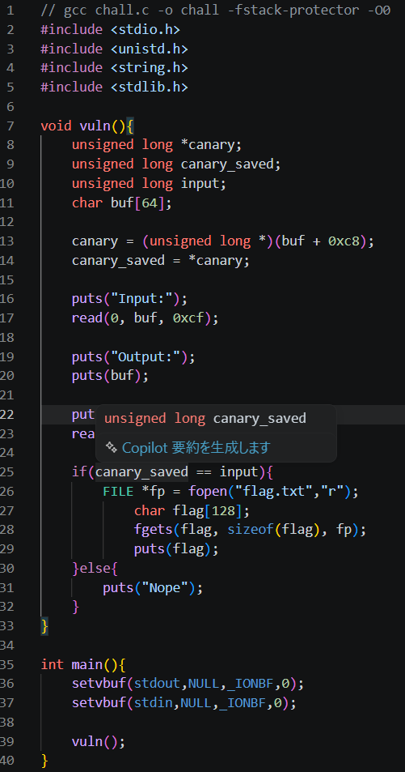

# Writeup
ライトアップ書きました。久木くんにプレゼントします。
## 目次
・ソースコードの確認
・値を漏らす
・値を復元する
・もとに戻し入力して判定を通す

## 攻略
## ソースコード



### 1.flagの入手条件
```c
read(0, &input, 8);

if (canary_saved == input) {
    // flagを表示
}
```

``vuln``の後半では、2回目の入力を``input``に読み込み、保存しておいた値と比較しているんやな..
したがって、攻略には``canary_saved``の値を知り、それを8バイトで送り返す必要がありそうやな...工藤

### 2.``canary_saved``の値
```c
canary = (unsigned long *)(buf + 0xc8);
canary_saved = *canary;
```

``canary``は``buf + 0xc8``を指すポインタや.``*canary``は、そのアドレスにある値を読みだすんや.ぼけ.
つまり、最初の入力より前に、``buf + 0xc8``にある8バイトが``canary_saved``に保存されているんやな..

### 3.漏らします。
```c
read(0, buf, 0xcf);
puts(buf);
```
``buf``は64バイトですが、最初の``read``は最大``0xcf``バイト読み込むんや
そのため、64バイトを超えて書き込めるんよ.
``puts``は``buf``の先頭から文字を出力し、NULバイトに達すると止まるね。じゃあ、初めに``a``を0xc8個送って、ついでに改行も送る。
元の値の先頭にあるNULバイトが改行で上書きされるため後続のバイトも出力される(漏れたで...久木くんの...)
実際にやってみると、

```
aaaaaaaaaaaaaaaaaaaaaaaaaaaaaaaaaaaaaaaaaaaaaaaaaaaaaaaaaaaaaaaaaaaaaaaaaaaaaaaaaaaaaaaaaaaaaaaaaaaaaaaaaaaaaaaaaaaaaaaaaaaaaaaaaaaaaaaaaaaaaaaaaaaaaaaaaaaaaaaaaaaaaaaaaaaaaaaaaaaaaaaaaaaaaaaaaaaaaaaa
\xe7\x96v \xa8\xa3\x9d\x10\xdf\xd9\xca\xfd\x7f
```
出たー！でた♡

### 4.漏れた物を復元する
元の値の先頭バイトはNULや。
リークした残りの7バイトの前に\x00を補うと、8バイトに戻すんや
出力中の200個のaと改行までをrecvuntilで読み飛ばし、その後の7バイトを受け取る。
復元した値を``Canary?``の後に送ると、read関数が``input``に読み込む。これでフラグが得られる。


[メモ]
>**デリファレンスとは**
ポインタが格納しているアドレスを使って、そのアドレスの先にある値にアクセスすること
>**ポインタとは**
メモリ上の特定の位置を指し示すための変数のこと
```c
read(fd, buf, count)
```
>この引数と意味は以下のとおりだよ。

|引数|意味|
|--|--|
|fd|読み込み元を指定するファイルディスクリプタ|
|buf|読み込んだデータを格納するメモリの先頭アドレス|
|count|最大なんバイト読み込むか|

今回のスタック
```
高いアドレス
┌──────────────────────────────┐
│ 戻りアドレス     [rbp+0x8]   │  8バイト
├──────────────────────────────┤
│ 保存された rbp   [rbp+0x0]   │  8バイト ← rbp
├──────────────────────────────┤
│ SSP canary       [rbp-0x8]   │  8バイト
├──────────────────────────────┤
│ パディング       [rbp-0x10]  │  8バイト
├──────────────────────────────┤
│ flag[128]        [rbp-0x90]  │
│                 ～[rbp-0x11] │
├──────────────────────────────┤
│ buf[64]          [rbp-0xd0]  │  ← buf の先頭
│                 ～[rbp-0x91] │
├──────────────────────────────┤
│ FILE *fp         [rbp-0xd8]  │  8バイト
├──────────────────────────────┤
│ canary_saved     [rbp-0xe0]  │  8バイト
├──────────────────────────────┤
│ canary ポインタ  [rbp-0xe8]  │  8バイト
├──────────────────────────────┤
│ input            [rbp-0xf0]  │  8バイト
└──────────────────────────────┘
低いアドレス
```

# 参考文献
[pwn入門](https://qiita.com/trimscash/items/71f417f99508f8ca78f8)

[SSP](https://qiita.com/GmS944y/items/b10a1abde35f7175ea4b)

